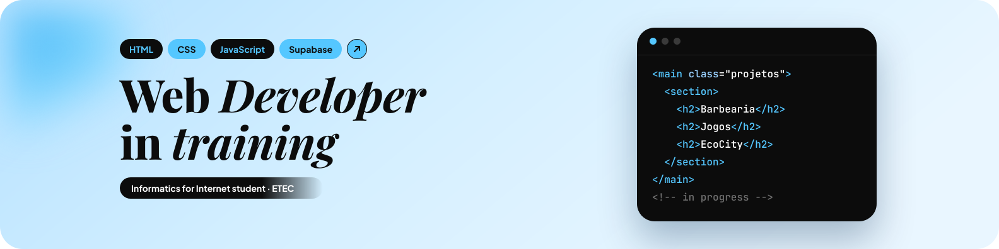
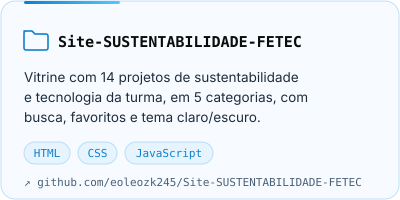
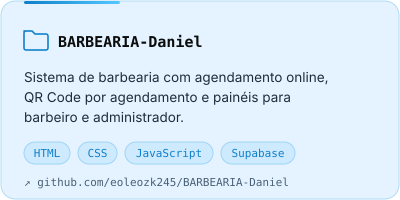
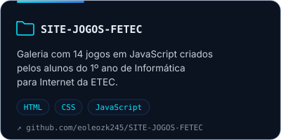
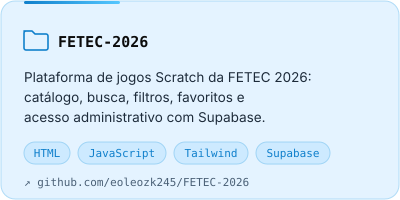
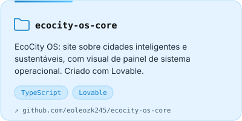
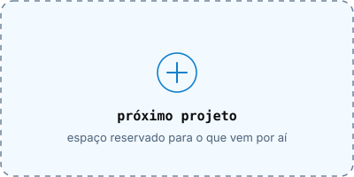

 

Sou **estudante de Informática para Internet** na **ETEC Darcy Pereira de Moraes**, em Itapetininga, SP. Meu foco é programação, desenvolvimento web e criação de soluções digitais.

Hoje estou aprimorando **HTML, CSS e JavaScript**, construindo páginas, interfaces responsivas e funcionalidades interativas, e também uso o **Supabase** nos meus projetos. Tenho interesse em **inteligência artificial**, **cibersegurança** e **desenvolvimento de software**.

Aprendo na prática, com estudo contínuo e projetos reais, para fortalecer minha lógica de programação e criar aplicações organizadas, funcionais e eficientes.

 

 

&nbsp;&nbsp;
&nbsp;&nbsp;

<h3 align="center">Linguagens</h3>

<h3 align="center">Ferramentas</h3>

 

 

 

 

 

 

